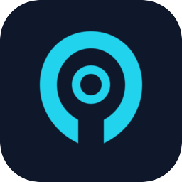
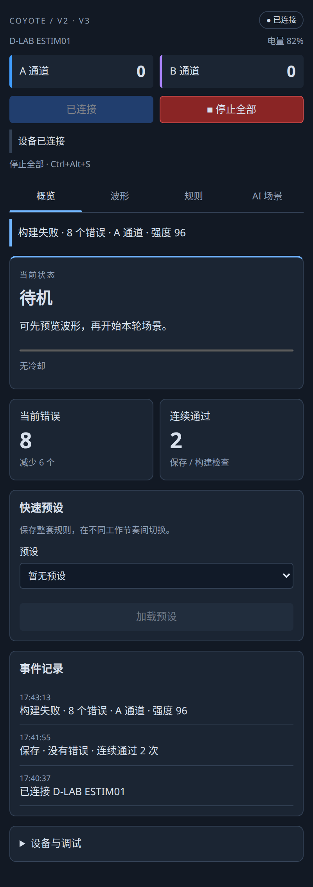

<p align="center">
  
</p>

<h1 align="center">Coyote V2/V3 Code Punisher</h1>

<p align="center">让每一个 Bug 都留下深刻印象。</p>

<p align="center">
  <a href="https://github.com/NanamiKite/CodeRecoil-for-Coyote-2.0"></a>
  <a href="https://marketplace.visualstudio.com/items?itemName=NanamiKite.coyote-2-code-punisher"></a>
  <a href="https://github.com/NanamiKite/CodeRecoil-for-Coyote-2.0/blob/master/LICENSE"></a>
  <a href="https://code.visualstudio.com/"></a>
</p>

<p align="center">
  <a href="#安装">安装</a> · <a href="#快速开始">快速开始</a> · <a href="#功能">功能</a> · <a href="#ai-场景">AI 场景</a> · <a href="#安全">安全</a>
</p>

<p align="center">
  
</p>

通过蓝牙连接郊狼 V2 / V3 主机，在 VS Code 保存文件、构建任务启动或构建失败时按错误数量自动触发电脉冲输出。也可以手动设置强度、通道和波形，或让 Codex、Claude Code、DeepSeek Harness 通过本地 MCP 主持场景。

*English:* Connect a Coyote V2/V3 host over Bluetooth LE, map VS Code diagnostics to bounded electrical-pulse feedback, and let local AI clients propose scenes through MCP.

> **使用前请阅读**：本插件会控制真实设备输出电脉冲。请确认设备状态、强度和冷却参数，并保持紧急停止可用。完整免责声明见[文末](#免责声明)。

## 安装

### 从 VS Code 商店

在扩展面板搜索 `Coyote V2/V3 Code Punisher`，或打开 [Marketplace 页面](https://marketplace.visualstudio.com/items?itemName=NanamiKite.coyote-2-code-punisher) 点击 Install。

### 从 VSIX 安装

如果已经拿到 `.vsix` 文件，在扩展面板选择 `...` → `从 VSIX 安装`，或执行：

```sh
code --install-extension coyote-2-code-punisher-2.2.0.vsix
```

### 从源码构建

<details>
<summary><b>安装依赖并打包 VSIX</b></summary>

需要 Node.js 20 或更新版本。

```sh
npm install
npm run package
```

生成的 `.vsix` 位于项目根目录。`npm run package` 会调用 `vsce package`，并把生产依赖（`webbluetooth`、MCP SDK 等）一起打进 VSIX。

</details>

## 快速开始

1. 点击 VS Code 活动栏的 Coyote 图标，打开侧边栏。
2. 点击「连接设备」，选择 `D-LAB` 前缀的 V2 主机或 `47L121` 前缀的 V3 主机。`47L120100` 是无线传感器，不在支持范围内。
3. 在「规则」页设置基础强度、上限、时长、输出通道和冷却，点击「保存规则」。需要自动输出时再勾选「启用保存 / 构建自动触发」。
4. 在「波形」页可以离线预览波形，也可以直接手动设置 A/B 强度、通道和时长。
5. 需要让 AI 主持剧情时，到「AI 场景」页开启 AI 接入，选择客户端并复制 MCP 配置。详见 [AI 场景接入](https://github.com/NanamiKite/CodeRecoil-for-Coyote-2.0/blob/master/docs/AI-scenes.md)。

## 功能

- **BLE 连接**：V2 使用 `D-LAB` 前缀，V3 使用 `47L121` 前缀；显示电量、连接阶段和等待时长，失败时保留阶段与底层错误。
- **自动触发**：保存文件、VS Code 构建任务启动或构建失败后读取诊断，按错误数映射强度与时长；支持只统计本次会话新增错误、同一批错误只触发一次。
- **规则试算**：固定、对数—幂律、多阶段阶跃三种映射，支持 A / B / AB 输出，规则按工作区保存，可保存为预设切换。
- **手动控制**：独立设置 A/B 强度、通道、时长和帧间隔，支持实时调节和离线波形预览。
- **AI 场景**：本地 stdio MCP 接入 Codex、Claude Code、DeepSeek Harness；AI 只能提交提案，必须在侧边栏点击应用才会输出。
- **安全机制**：紧急停止、冷却、强度钳制、串行写入和取消机制，手动 / 自动 / AI 共用一套执行队列。

## 自动触发

在规则页保存并开启「自动触发」后，以下事件会安排一次延迟检查：

1. **保存文件**：等待 500ms 后读取诊断；继续编辑会取消待处理检查。
2. **构建任务启动**：识别 build 分组或名称包含 build / compile / tsc / webpack / vite 的 VS Code Task。
3. **构建任务失败结束**：补读后续编译诊断，相同错误集合不重复执行。

诊断变化只更新计数，不直接启动输出。终端手动运行的命令若不是 VS Code Task，不在监听范围内。可选择统计当前文件或工作区，也可以只统计相对扩展启动时诊断快照的新增错误；位置或错误文本改变也会视为新诊断。语言服务没有统一的「诊断已完成」事件，500ms 检查不保证覆盖所有延迟报告。配置按工作区保存，自动触发每次重新加载默认关闭。

### 错误数映射

连续模式采用 `S = base + A × ln(1 + 0.15 × e^1.4)`，`A` 根据用户上限归一化到 100 个错误。阶跃模式默认 1–3 提醒、4–15 警示、16+ 疏密变化，两个阈值可以在规则页更改；这些是可调默认值，不代表错误数量与故障严重性的统计结论。关闭「随错误数调整」时固定使用基础值，0 个错误不自动输出。

每次触发后进入冷却期（默认 15 秒），冷却时间内所有事件忽略，侧边栏显示倒计时。自动 / AI 场景受规则中的强度和时长上限限制。阶跃内建波形采用可重复序列，使预览与实际发送计划一致。

## 手动操作

在「波形」页顶部的手动控制区操作，不需要先保存规则：

- 设置 A/B 强度后点击「设置 A/B 强度」，立即写入设备，不要求波形正在运行。
- 勾选「实时调节」后，滑块、数字框和加减按钮的修改会自动写入；运行中的波形不会重新计时。
- 波形输出通道可以独立选 A、B、A+B，运行中也可以切换。有强度但没有激活波形时不会持续输出。
- 「停止波形」或手动波形到时会结束波形并保留强度设置；「停止全部」会把两通道强度归零。
- 顶部和手动区显示写入成功后的强度；设备支持通知时同步设备端变化，也可以点击「从设备读取」回读。

强度显示是控制值，不是输出电压或体感测量。修改自动规则不会覆盖手动输入或中断手动波形。

## AI 场景

AI 场景通过本地 MCP Server 接入 VS Code Codex、Claude Code（CC）或 DeepSeek Harness。插件显示 AI 提案和执行状态，不另建聊天窗口，也不直接请求模型 API。

1. 在「AI 场景」页开启 AI 接入，选择客户端并复制 MCP 配置。
2. 把配置放进所选客户端的个人本地配置，不要提交到仓库。
3. 在客户端对话中读取 Coyote 状态、列出场景并提交提案。提案会在侧边栏显示通道、强度、时长和理由。
4. 点击「应用场景」才会发送波形；跳过、过期或修改规则都会撤销提案。提案两分钟后过期。

本地桥接只监听 `127.0.0.1` 的随机端口，每次开启生成新令牌；MCP 子进程的 stdout 仅传输协议消息。适配器不提供直接启动、提高上限、修改通道、任意 BLE 字节或任意波形的工具。完整的配置片段和「写代码闯关」玩法见 [AI 场景接入](https://github.com/NanamiKite/CodeRecoil-for-Coyote-2.0/blob/master/docs/AI-scenes.md)。

## 连接与排查

点击「连接设备」后，侧边栏会显示搜索设备、GATT 连接、读取服务与特性、读取电量、订阅通知等阶段及等待时长，VS Code 同时显示连接进度通知。初始化完成才显示「已连接」，期间不能重复发起连接。

连接失败时会保留失败阶段和底层错误，并显示「重试连接」。请检查电脑蓝牙、设备电源和距离，以及手机 App 或其他程序是否占用设备。等待超过 15 秒会显示排查提示，这只是等待提醒，不代表操作已超时或被取消。意外断开也会在顶部显示提示。

### V3 主机

连接时按设备名称识别 V2 / V3。V3 使用 `0x180C` 的 WRITE `150A` 与 NOTIFY `150B`；A/B 通道的波形数据合并为每 100ms 一条 B0。现有波形帧的 `X+Y` 换算为 V3 周期字节，`Z×5` 换算为波形强度，波形暂停帧使用强度 0。手动帧间隔仍可设置，V3 每 25ms 采样一次计划波形，合成四组数据发送。

根据[郊狼 V3 开放协议](https://github.com/dungeonlab-open/dglab-bluetooth-protocol/blob/main/coyote/v3/README.md)，每次连接均发送 BF。当前写入 A/B 软上限各 200、频率平衡参数各 128、强度平衡参数各 128；这些 BF 参数会保存在设备中，也会覆盖设备此前的对应设置。连接后先发送两通道强度归零指令，再允许控制。

V3 的强度仅通过 B1 通知回报，没有主动读取特性。插件写入绝对强度时使用 B0 序列号 0，因此设备无需针对该次写入回报；界面先显示写入的控制值，收到例如设备拨轮触发的 B1 时再同步设备值。「使用最近 B1 回报」只有收到通知后才可用；在此后再次写入强度，该回报不再作为当前强度供回填。

## 安全

- 手动、自动和 AI 场景共用串行写入与取消机制；自动 / AI 场景受规则上限及冷却限制。
- 手动模式独立设置 A/B 强度（0–200）、波形通道、时长（100–30000ms）和帧间隔（20–5000ms），不使用自动规则的上限或冷却。
- 波形 Z 值自动钳制到 15 以下（Z>20 脉冲宽度超 100us，产生刺痛）。
- 紧急停止会取消待执行场景、清除定时器、使旧发送失效并归零；侧边栏「停止全部」还会关闭自动触发。
- 设备断开时自动清除全部状态。`CoyoteSafety` 独立于 UI，即使绕过 webview 也不会超过协议上限 2047。
- BLE 断连或底层调用挂起时，软件不能保证硬件已收到归零指令。界面展示发送计划与软件状态，而非电气测量。

紧急停止快捷键：`Ctrl+Alt+S`。

## 开发

```sh
npm install
npm test
npm run test:ui
npm run package
```

`npm test` 使用模拟 BLE，不会连接真实设备。界面测试在 Windows 使用已安装的 Edge，其他平台需要先安装 Playwright Chromium。

<details>
<summary><b>项目结构</b></summary>

```text
src/
├── extension.js              # 插件入口，注册命令与事件监听
├── coyote/
│   ├── CoyoteProtocol.js      # BLE 数据包编码/解码
│   ├── CoyoteProtocolV3.js    # V3 B0/B1/BF 编解码
│   ├── CoyoteController.js    # 设备连接、强度/波形控制、惩罚触发
│   ├── CoyoteSafety.js        # 安全阈值钳制
│   ├── rules.js               # 试算与执行映射
│   ├── SceneRuntime.js        # 串行写入和取消
│   └── CodeChallenge.js       # 写代码闯关
├── mcp/
│   ├── server.js              # 独立 stdio MCP 入口
│   ├── LocalBridge.js          # 127.0.0.1 本地桥接
│   └── configs.js              # 客户端配置片段
└── ui/
    ├── CoyoteSidebarProvider.js # 侧边栏 Webview
    └── dashboardHtml.js         # 侧边栏 HTML
```

</details>

## 免责声明

<details>
<summary><b>完整免责声明</b></summary>

重要：本项目仅供技术研究、软件开发与个人实验使用。

Coyote V2/V3 Code Punisher 会通过 BLE 控制兼容设备输出电脉冲，并支持根据 VS Code 的诊断、编译失败及保存事件自动触发输出。用户应充分了解所连接设备及其输出特性，并自行确认设备适用于当前使用场景。

本项目作者及贡献者不对因使用本插件、修改源码、连接第三方设备、设备故障、协议实现差异、配置错误、自动触发、异常断连或其他不可预见情况所造成的任何直接或间接损失、设备损坏、人身伤害或其他后果承担责任。

插件内置的强度、时长、波形及协议范围限制属于软件层面的安全措施，不构成对设备实际输出或使用安全性的保证。不同硬件、固件版本及设备状态可能导致实际行为与软件预期存在差异；不得仅依据本插件中的限制判断设备是否安全。

使用自动触发功能前，请确认：

- 设备处于适当且可控的使用状态；
- 已了解设备制造商提供的安全说明及限制；
- 已正确配置强度、时长、冷却时间等参数；
- 能够在异常情况下立即停止设备输出；
- 不将自动触发功能用于无法随时人工干预的场景。

如出现异常输出、设备行为异常、无法停止或任何不确定情况，应立即停止使用并断开设备。

使用本项目即表示你理解并接受上述风险，并自行承担使用本项目及相关设备产生的责任。

</details>

## 许可证

[GPL-3.0-only](https://github.com/NanamiKite/CodeRecoil-for-Coyote-2.0/blob/master/LICENSE)。许可证全文见仓库根目录的 `LICENSE`。
